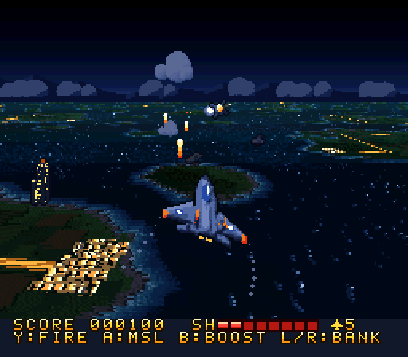
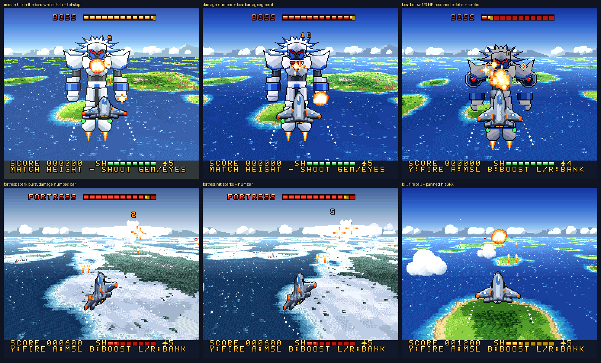

# SUPER SKY FURY

**A Mode 7 jet-combat shooter for the Super Nintendo, written in 65816 assembly.**
Developed by **Naveed Farbakhsh**.

### ▶ [Play it in your browser: naveedster.github.io/super-sky-fury](https://naveedster.github.io/super-sky-fury/)


Fly a fighter jet across four stages (ocean, desert, arctic, and a night raid) over procedurally
generated islands, towns, and airfields. Shoot down enemy waves and an armoured sky fortress, grab
power-ups, out-turn heat-seeking missiles, and take on a giant robot boss, with a loud, wide stereo
soundtrack and sound effects. The game runs on real SNES
hardware (through a flash cart such as an FXPak Pro/SD2SNES or EverDrive) and in any accurate
SNES emulator.

| | |
|---|---|
|  |  |
|  |  |
|  |  |
|  |  |

## Features

* **Three camera views**: a chase camera and a cockpit with a full instrument panel (radar,
  attitude ball, altitude and speed), both using per-scanline Mode 7 perspective, plus a
  rotating overhead view with translucent shadows.
* **Combat**: twin cannons, lock-on heat-seeking missiles, an afterburner, and hard banking.
  Enemies fire tracers and missiles, with on-screen warnings telling you how to dodge.
* **Four stages**: OCEAN STRIKE, DESERT STORM, ARCTIC FRONT, and NIGHT RAID, each with its own
  Mode 7 ground, sky, and haze, then the boss.
* **Enemy variety**: fighters in scripted formations, swoopers, fast darts, kamikazes, armoured
  bombers that smoke and shoot back, and a six-engine **sky fortress** mid-boss with its own health bar.
* **Power-ups and combo**: SPREAD gun (P), RAPID missiles (M), and SHIELD (S) capsules, plus a kill
  combo multiplier with floating "+N00 xM" score pop-ups.
* **Hit feedback**: impact sparks, white hit flashes, knockback jolts, hit-stop, floating damage
  numbers, smoke and scorch marks on damaged armour, a boss bar with a lagging damage segment, bigger
  effects for missiles and weak points, and panned hit sounds.
* **Sprite-stacked 3D sprites**: the player jet, the enemy planes, the robot boss, tumbling debris,
  missiles and power-up capsules, and each stage's ground props (carriers, oil rigs, palm islands,
  pyramids, mesas, radar stations, tanks, icebergs, snow pines, igloo bases, gun turrets, lit
  skyscrapers) are small voxel models rendered offline by sprite stacking. The game picks the
  frame from the object's heading relative to the camera and streams only the frames in use to VRAM.
* **Ground attack**: AA bunkers, tanks, and turrets can be shot (3 hits) for 300 points.
* **Boss fight**: a giant sprite-stacked robot whose head tracks you and whose arms swing into
  cannon and spread poses, with weak points, three attack phases, and its own music.
* **Original 16-bit soundtrack**: title, stage, and boss themes plus a victory jingle on a
  custom SPC700 sound driver. Sound effects are hard-panned and moving (STEREO by default, with
  a MONO option).
* **Title screen and menu**: an animated Mode 7 background, OPTIONS (difficulty, stereo/mono,
  music test, sound test), and CREDITS.
* **Three difficulty levels**:

  | | Lives | Boss health | Enemy fire |
  |---|---|---|---|
  | EASY | 7 | lower | slower |
  | NORMAL | 5 | standard | standard |
  | HARD | 3 | higher | faster |

* Runs at a steady **60 fps** on a stock console: 1 MB LoROM/FastROM, no enhancement chip,
  NTSC.

| Menu | Options | Credits |
|---|---|---|
|  |  |  |




## Play it

* **In your browser:** <https://naveedster.github.io/super-sky-fury/>. It uses an embedded snes9x
  emulator (EmulatorJS) with stereo sound, keyboard, gamepad, and on-screen touch controls.
* **Download:** grab **[`dist/super_sky_fury.sfc`](dist/super_sky_fury.sfc)** (or the ROM attached to
  the [latest release](https://github.com/naveedster/super-sky-fury/releases/latest)) and open it in an
  emulator, or copy it to a flash cart.

## Controls

| Button | Action |
|---|---|
| START | title: open the menu; in game: pause / resume; GAME OVER: back to the title |
| D-pad | menu: choose (left/right changes an option) |
| A / START | menu: confirm. B: back |
| D-pad left/right | turn (the jet banks) |
| D-pad up/down | climb / dive |
| Y (hold) | guns |
| A | heat-seeking missile (locks onto the nearest enemy ahead) |
| B | afterburner |
| L / R | hard bank (tighter turn) |
| SELECT or X | change view: chase -> overhead -> cockpit (chase <-> cockpit during the boss) |

Scoring: 100 points for a gun kill and 200 for a missile kill. You get an extra life every
10,000 points (up to 9).

## Building from source

Requirements:

* [cc65](https://cc65.github.io/) (`ca65` and `ld65`)
* Python 3 with `numpy` and `Pillow`

```sh
./build.sh
```

The script regenerates all graphics, tables, and music from the Python generators in `tools/`
and `music/`, assembles `src/main.s`, links it with `src/lorom.cfg`, and fixes the header
checksum. The output is `build/super_sky_fury.sfc`. The build is deterministic and reproduces
the ROM in `dist/` byte for byte.

```
src/        65816 source (main loop and rendering, combat, enemy attacks, boss, title/menu)
tools/      asset generators (terrain, sprites, boss, title logo), checksum fixer,
            headless libretro test harness (lrharness.c), test scripts
music/      SPC700 driver, BRR encoder, song and SFX generators, plus .spc/.mp3 renders
tests/      scripted title-menu test runs
docs/       website (GitHub Pages), technical notes, screenshots
dist/       the release ROM
```

## Tested on

| Emulator | Result |
|---|---|
| snes9x (libretro) | works |
| Snes9x 1.55, the core used by Delta (iOS) | works, same gameplay frame for frame as snes9x |
| bsnes (default and accuracy settings) | works |
| bsnes2014 accuracy | works, 60 fps with no dropped frames |
| Mesen-S | works |

Audio has also been checked on snes9x2002/2005/2010, bsnes-hd, bsnes-mercury, and Mesen2.
For the full test methodology and the hardware-safety rules the code follows, see
[docs/TECHNICAL.md](docs/TECHNICAL.md).

## Changelog

### v1.2 (2026-11-20)

* **Sprite-stacked robot boss**: the boss is now a voxel model (`tools/boss_vox.py`) built as
  separate layers: a body with the chest gem, a head with the spiky crest that turns toward you
  (5 headings), and arms with down, cannon (the firing arm recoils), and spread poses. The arms
  "breathe" while idle. The damaged body has holes, scorch rims, and soot streaks, on top of the
  scorched palette, smoke, and sparks. The hit boxes (gem, eyes, body) are unchanged.
* **Tumbling objects**: debris chunks, your missiles, enemy missiles, the P/M/S capsules, and the
  boss's crest shards tumble or roll through 8 sprite-stacked frames each. A frame is only streamed
  when an object of that kind is on screen, at most one per vblank.
* **Ground props per stage**: 13 new voxel models with 16 headings and 3 distance sizes. OCEAN has
  carriers, oil rigs, palm islands, and AA bunkers. DESERT has pyramids, mesas, radar stations, and
  tanks. ARCTIC has icebergs, snow pines, igloo bases, and gun turrets. NIGHT has lit skyscrapers.
  Props now also stand on open water. Each stage recolours the prop palette.
* **Shootable ground targets**: bunkers, tanks, and turrets take 3 hits (spark and metallic tink on
  each hit). Then they go up in a fireball that stays on the ground, with a panned explosion and
  +300 points. They stay destroyed until the next stage.
* **Night palettes**: in NIGHT RAID your jet, the enemies, and the props are drawn darker and bluer,
  while lamps, flames, and windows stay lit.
* **Performance**: prop offsets are pre-rotated for all 256 headings (a table in ROM instead of
  four multiplies per prop), bases behind the camera are skipped, and the prop frame budget is
  tighter. Scripted stress runs stay close to v1.1 (see TECHNICAL.md).
* The ROM is now 1 MB (prop frames live in banks $90-$95).

### v1.1 (2026-11-20)

* **More variety**: four stages (OCEAN STRIKE, DESERT STORM, ARCTIC FRONT, NIGHT RAID), each with
  its own Mode 7 ground, sky, and haze. New enemies: armoured bombers, kamikazes, darts, swoopers,
  scripted formations, and the sky fortress mid-boss.
* **Power-ups and combo**: SPREAD gun, RAPID missiles, and SHIELD +8 capsules (every 7th kill drops
  one, and capsules drift toward you), and a kill combo multiplier.
* **Hit feedback** (sparks, white flash, knockback, hit-stop, floating damage numbers, armour and
  boss damage states, a lagging and flashing boss bar, bigger missile and weak-point hits, panned
  hit sounds), plus screen shake, bigger explosions, and a boss intro.
* **Sprite stacking**: voxel models for the jet, enemy planes, bombers, the fortress, and new ground
  props, rendered offline at 16 headings (the jet also has 5 bank levels x level/climb/dive), and
  quantized to the SNES 15-colour sprite palettes with shading and outlines (`tools/voxstack.py`).
  The NMI streams only the frames in use (one 64x64 jet slot and six 32x32 slots) inside a
  scanline budget, so VRAM is still written only during vblank.
* **Fixes**: no more silence when the music switches (the boss warp gap went from 1.10 s to 0 s, and
  the worst gap in a busy run from 1.65 s to 0.03 s). Faster sprite emission, cheaper overhead
  contrails, and a frame budget for ground-table rebuilds and ground props keep the extra enemies and
  effects at 60 fps in nearly every frame (over 99.9% in the scripted test runs).
* Boss health (150 HP on loop 1) and lives per difficulty are unchanged.

### v1.0

* First release: three camera views, combat, the robot boss, title screen and menu, stereo
  soundtrack, and the in-browser player.

## Credits

* **Game design, direction, and development**: Naveed Farbakhsh
* All code, graphics, music, and sound effects are original to this project.
* The logo font is [Russo One](https://fonts.google.com/specimen/Russo+One) by Jovanny Lemonad,
  under the SIL Open Font License 1.1 (`tools/fonts/OFL.txt`). It is used only at build time to
  render the logo tiles.
* Inspired by the "fly" web demo by [@creativedash](https://x.com/creativedash/status/2122000830895386680).
  No assets from it are used.

## License

[MIT](LICENSE). Copyright (c) 2026 Naveed Farbakhsh.

The Russo One font file in `tools/fonts/` remains under the SIL Open Font License 1.1.
