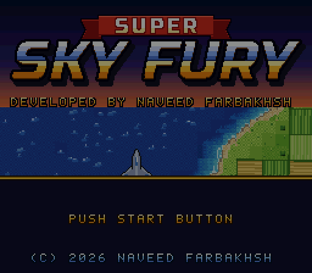
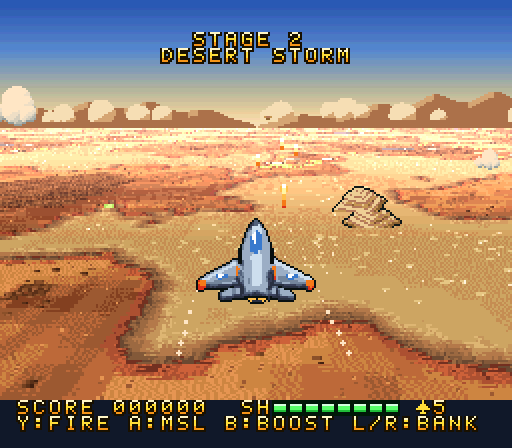
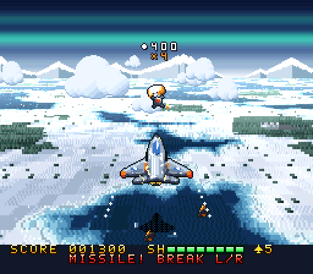
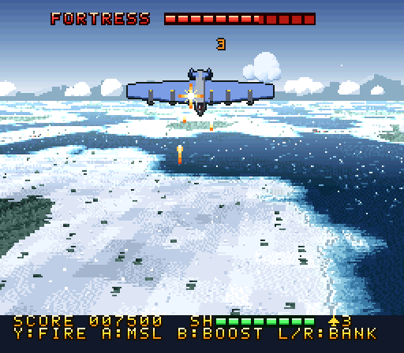
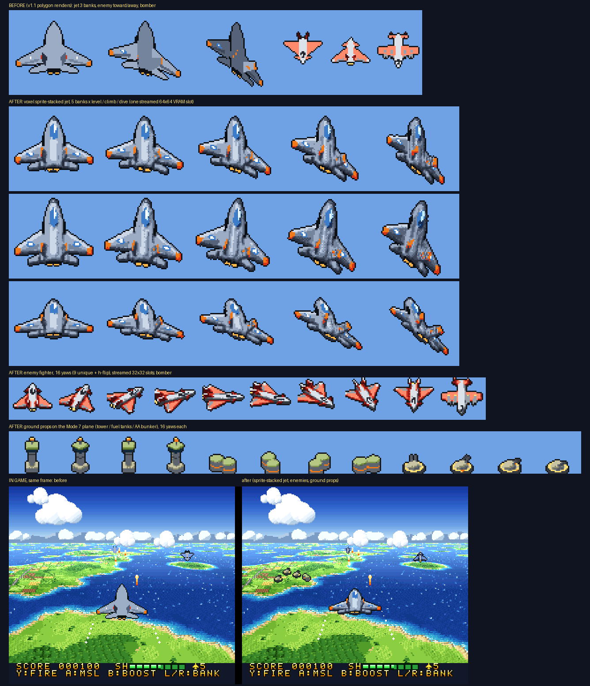
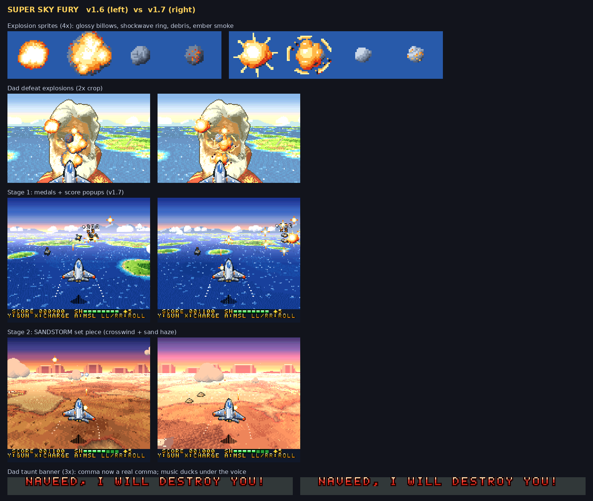
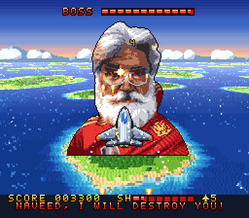
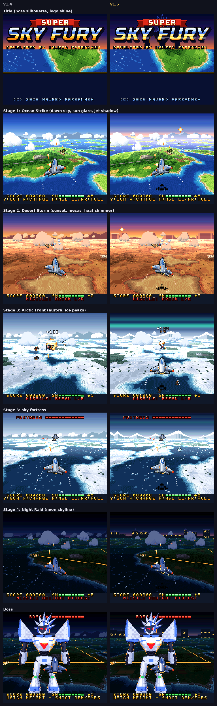
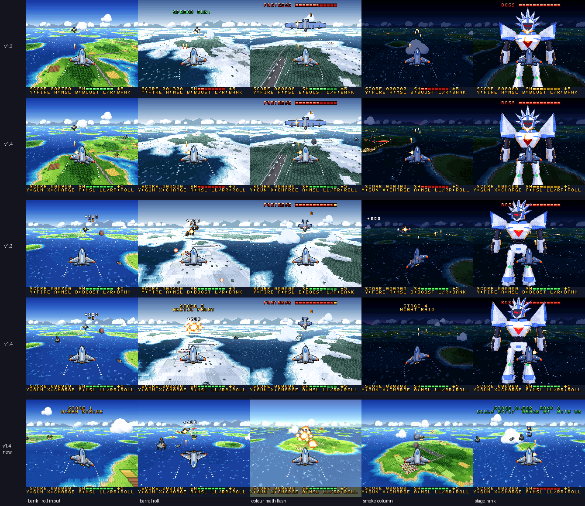

# SUPER SKY FURY

**A Mode 7 jet-combat shooter for the Super Nintendo, written in 65816 assembly.**
Developed by **Naveed Farbakhsh**.

### ▶ [Play it in your browser: naveedster.github.io/super-sky-fury](https://naveedster.github.io/super-sky-fury/)



Fly a fighter jet across four stages (ocean, desert, arctic, and a night raid) over procedurally
generated islands, towns, and airfields. Shoot down enemy waves and an armoured sky fortress, grab
power-ups, out-turn heat-seeking missiles, and take on a giant robot boss, with a loud, wide stereo
soundtrack and sound effects. The game runs on real SNES
hardware (through a flash cart such as an FXPak Pro/SD2SNES or EverDrive) and in any accurate
SNES emulator.

| | |
|---|---|
|  |  |
|  |  |
|  |  |
|  |  |

## Features

* **Three camera views**: a chase camera and a cockpit with a full instrument panel (radar,
  attitude ball, altitude and speed), both using per-scanline Mode 7 perspective, plus a
  rotating overhead view with translucent shadows.
* **Combat**: twin cannons, lock-on heat-seeking missiles, an afterburner, and hard banking.
  Enemies fire tracers and missiles, with on-screen warnings telling you how to dodge.
* **Four stages**: OCEAN STRIKE, DESERT STORM, ARCTIC FRONT, and NIGHT RAID, each with its own
  Mode 7 ground, animated sky (dawn, sunset, aurora, neon night), horizon band, and haze, then the boss.
* **Enemy variety**: fighters in scripted formations, swoopers, fast darts, kamikazes, armoured
  bombers that smoke and shoot back, and a six-engine **sky fortress** mid-boss with its own health bar.
* **Power-ups and combo**: SPREAD gun (P), RAPID missiles (M), and SHIELD (S) capsules, plus a kill
  combo multiplier with floating "+N00 xM" score pop-ups.
* **Hit feedback**: impact sparks, white hit flashes, knockback jolts, hit-stop, floating damage
  numbers, smoke and scorch marks on damaged armour, a boss bar with a lagging damage segment, bigger
  effects for missiles and weak points, and panned hit sounds.
* **Sprite-stacked 3D sprites**: the player jet, the enemy planes, the robot boss, tumbling debris,
  missiles and power-up capsules, and each stage's ground props (carriers, oil rigs, palm islands,
  pyramids, mesas, radar stations, tanks, icebergs, snow pines, igloo bases, gun turrets, lit
  skyscrapers) are small voxel models rendered offline by sprite stacking. The game picks the
  frame from the object's heading relative to the camera and streams only the frames in use to VRAM.
* **Ground attack**: AA bunkers, tanks, and turrets can be shot (3 hits) for 300 points.
* **Boss fight**: a towering glossy white-and-cobalt mech, pre-rendered in 3D, whose head tracks
  you. It fires wrist cannons and shoulder missile pods, charges a blue energy swirl before its chest
  beam, and spins to throw a ring of plasma orbs. It has weak points, three attack phases, and its
  own music.
* **Original 16-bit soundtrack**: title, stage, and boss themes plus a victory jingle on a
  custom SPC700 sound driver. Sound effects are hard-panned and moving (STEREO by default, with
  a MONO option).
* **Title screen and menu**: an animated Mode 7 background, OPTIONS (difficulty, stereo/mono,
  music test, sound test), and CREDITS.
* **Three difficulty levels**:

  | | Lives | Boss health | Enemy fire |
  |---|---|---|---|
  | EASY | 7 | lower | slower |
  | NORMAL | 5 | standard | standard |
  | HARD | 3 | higher | faster |

* Runs at a steady **60 fps** on a stock console: 1 MB LoROM/FastROM, no enhancement chip,
  NTSC.

| Menu | Options | Credits |
|---|---|---|
|  |  |  |




## Play it

* **In your browser:** <https://naveedster.github.io/super-sky-fury/>. It uses an embedded snes9x
  emulator (EmulatorJS) with stereo sound, keyboard, gamepad, and on-screen touch controls.
* **Download:** grab **[`dist/super_sky_fury.sfc`](dist/super_sky_fury.sfc)** (or the ROM attached to
  the [latest release](https://github.com/naveedster/super-sky-fury/releases/latest)) and open it in an
  emulator, or copy it to a flash cart.

## Controls

| Button | Action |
|---|---|
| START | title: open the menu; in game: pause / resume; GAME OVER: back to the title |
| D-pad | menu: choose (left/right changes an option) |
| A / START | menu: confirm. B: back |
| D-pad left/right | turn (the jet banks) |
| D-pad up/down | climb / dive |
| Y (hold) | guns |
| X (hold, release) | charge shot: hold until CHARGE READY, let go to fire a big piercing blast |
| A | heat-seeking missile (locks onto the nearest enemy ahead) |
| B | afterburner |
| L / R | hard bank (tighter turn) |
| L L or R R (double-tap) | barrel roll that way: you can't be hit while rolling |
| SELECT | change view: chase -> overhead -> cockpit (chase <-> cockpit during the boss) |

Scoring: 100 points for a gun kill and 200 for a missile kill. A near miss (graze) is worth 100
points (200 if you roll through the bullet) and fills part of the charge meter. After each stage you get
a rank from S to C, based on kills, grazes, and hits taken. You get an extra life every
10,000 points (up to 9).

## Building from source

Requirements:

* [cc65](https://cc65.github.io/) (`ca65` and `ld65`)
* Python 3 with `numpy` and `Pillow`

```sh
./build.sh
```

The script regenerates all graphics, tables, and music from the Python generators in `tools/`
and `music/`, assembles `src/main.s`, links it with `src/lorom.cfg`, and fixes the header
checksum. The output is `build/super_sky_fury.sfc`. The build is deterministic and reproduces
the ROM in `dist/` byte for byte.

```
src/        65816 source (main loop and rendering, combat, enemy attacks, boss, title/menu)
tools/      asset generators (terrain, sprites, boss, title logo), checksum fixer,
            headless libretro test harness (lrharness.c), test scripts
music/      SPC700 driver, BRR encoder, song and SFX generators, plus .spc/.mp3 renders
tests/      scripted title-menu test runs
docs/       website (GitHub Pages), technical notes, screenshots
dist/       the release ROM
```

## Tested on

| Emulator | Result |
|---|---|
| snes9x (libretro) | works |
| Snes9x 1.55, the core used by Delta (iOS) | works, same gameplay frame for frame as snes9x |
| bsnes (default and accuracy settings) | works |
| bsnes2014 accuracy | works, 60 fps with no dropped frames |
| Mesen-S | works |

Audio has also been checked on snes9x2002/2005/2010, bsnes-hd, bsnes-mercury, and Mesen2.
For the full test methodology and the hardware-safety rules the code follows, see
[docs/TECHNICAL.md](docs/TECHNICAL.md).

## Changelog

### v1.7 (2026-11-25): Medals, set pieces, checkpoints, new explosions



* **Score medals.** Every second kill drops a twinkling medal. Each one you catch is worth the next step on the
  ladder (100, 200, 300, 500, 800, 1000, 1500, 2000, 3000, 5000), shown as an orange "+N00" popup where you
  caught it; at the top it pays 5000 each ("MEDALS MAXED!"). Let a medal fall past you and the ladder resets
  ("MEDAL CHAIN LOST" once you were on a good run). The stage rank now counts medals too.
* **A set piece in every stage.** Ocean: a bomber convoy flying line abreast with dart escorts, medals x2 while
  it lasts. Desert: a sandstorm with a gusting crosswind that pushes you sideways and thick sand haze.
  Arctic: a blizzard (crosswind plus white-out haze) full of kamikazes. Night city: a flak barrage, with shells
  bursting around you that throw shrapnel, so keep moving.
* **Checkpoints and continue.** Each stage has mid-stage checkpoints ("CHECKPOINT!"). At game over, press START
  to continue from the last one with full lives (the score restarts), or SELECT for the title screen.
* **Difficulty curve:** enemy bursts come slower in Stage 1 and faster by Stage 4. Rank thresholds are retuned
  (S 96 / A 80 / B 56).
* **New explosions:** glossy pre-rendered fireballs (lit billows, a white-hot core and flash spikes), a cooling
  frame with a shockwave ring and flying debris, and ember-lit smoke puffs (`tools/boom17.py`).
* **Dad is louder than the music.** The music ducks by about 12 dB while he says "Naveed, I will destroy you!",
  and comes back when the line ends. The comma in his banner is now a real comma.
* Flying through a cloud is a light mist you can see through instead of a white-out. In overhead view the jet's
  shadow now blinks with the jet after a hit instead of staying behind.
* Still a 1 MB LoROM FastROM cart with no enhancement chips.

### v1.6 (2026-11-20): Dad is the Stage 1 boss



* **Stage 1 boss: Naveed's dad.** Stage 1 now ends with a giant hovering bust of my dad (silver hair, white beard,
  rimless glasses, red Spain jersey), converted from a photo to a 128x144, 15-colour sprite (`tools/dad/dad_art.py`;
  the finished sprite is `tools/dad/dad_px.png`, the photo itself is not in the repo). He bobs, his eyes and
  lenses glow red before each attack, flashes white when hit, gets sooty with a cracked lens as he weakens, and
  goes out in a chain of explosions. Beating him clears Stage 1 ("DAD DEFEATED!", +3000) and you go on to Stage 2.
* **He talks.** At his entrance he says "Naveed, I will destroy you!": a 2.3 s, 9 kHz BRR voice sample
  (edge-tts, EQ'd and compressed, `tools/dad/make_voice.sh`) played by the SPC700 on the second SFX channel, with
  the banner `NAVEED, I WILL DESTROY YOU!` on the HUD for about 3.8 s. Music and other sounds keep playing.
* **A fair first boss.** He uses the same attacks as the robot (aimed cannon fans, volleys, the beam with its warning, shards), with 3/4 of
  its health and longer breaks between attacks. Shoot his glasses (match his height). His fight is in chase view.
* The Stage 4 robot boss is unchanged. Still a 1 MB LoROM FastROM cart with no enhancement chips.
* Tested on snes9x, snes9x 1.55 (Delta) and Mesen-S: from the title through Stage 1, the dad's entrance, taunt,
  voice, fight and defeat, into Stage 2. Separate test builds also beat him and the Stage 4 robot on all three cores.

### v1.5 (2026-11-20): graphics push



* **Glossy pre-rendered look**: the player jet, enemy planes, bombers, the sky fortress, and the larger ground
  props are re-rendered with a shiny key light, a specular streak, a warm rim light on the back edges, and
  dithered, quantized palettes.
* **Per-stage skies and horizons**: an ocean dawn, a deep desert sunset, an arctic twilight with an aurora,
  and a night city with neon palette cycling. Each sky gradient animates slowly (16 phases, streamed by
  HDMA), and each stage has its own horizon band: islands, desert mesas, snowy ice peaks, and a city skyline
  with lit windows.
* **HDMA effects**: haze that thickens toward the horizon, a low sun on the dawn and sunset stages with a
  glare that brightens as you turn toward it, and per-line heat shimmer over the desert.
* **Colour math**: a soft shadow under your jet that follows your altitude, and a white-out when you fly
  straight through a cloud.
* **Title screen**: the boss looms in silhouette behind the logo, and a shine band sweeps across the logo.
* **Performance**: chase view drops fewer frames than v1.3 and v1.4, even with the new effects. The contrail
  OAM build is cached, and the Mode 7 vertical-scroll tables are built only for the desert shimmer (a fixed
  ramp table is used elsewhere). See TECHNICAL.md.

### v1.4 (2026-11-20)



* **Barrel roll**: double-tap L or R. The jet rolls and slides sideways, and you can't be hit while it rolls.
  The whoosh circles your head in stereo, passing behind you.
* **Charge shot**: hold X until CHARGE READY beeps, then let go. A white-hot blast flies straight ahead and
  passes through enemies. It also hurts the boss and flattens ground targets.
* **Graze bonus**: a bullet that just misses gives points, a spark on that wing, and a whoosh in that ear.
  It also fills part of the charge meter. Rolling through a bullet counts double.
* **Weapon levels**: P capsules now stack: LV2 spread, then LV3 MAX POWER (all three lanes on every
  round, a faster rate of fire, and wider hits).
* **Stage rank**: STAGE CLEAR shows S/A/B/C with kills, grazes, and hits taken.
* **Ground targets fixed**: hits are now checked on every physics frame, with sweeping, at any altitude,
  so bullets no longer pass through bunkers, tanks, and turrets. Destroyed targets flash and leave a
  rising smoke column.
* **Graphics**: shimmering Mode 7 water (palette cycling for swell, crests, foam, and shallows), a sunset
  sky over the desert, a city glow on the night horizon, shockwave rings on big explosions, muzzle
  flashes, a charge glow on the nose, and boss shoulder pads that sweep up and frame the head.
* **Controls**: X is now the charge shot, and the view change is on SELECT only.
* **Performance**: the effects cost about 1 to 2 scanlines per frame. To pay for them, the contrail loop
  is leaner and the new effects skip work when idle. Ground-target checks run every other frame, and
  smoke and rings drop to a light version on busy frames. Boss fight: same as v1.3. See TECHNICAL.md.

### v1.3 (2026-11-20)

* **Redesigned boss**: the robot now matches the reference mech: glossy white armour with sharp
  highlights, cobalt shoulders, forearms, shins, and crest, a crown of white and blue spikes, a black
  visor with red eyes, a glowing red triangle gem, a ribbed dark waist, flared lower legs, and green
  knee nodes. It is rendered offline with a small raytracer (`tools/boss_rt.py`: cool key light,
  warm orange rim, specular highlights, ordered dither to the 15-colour sprite palette).
* **Bigger, low-angle framing**: the boss is drawn from a low camera and stands much taller on
  screen (up to 96 sprites per frame). Its hover is slower and heavier.
* **No swords**: wrist cannons (the muzzle flash and recoil come from the firing wrist) and
  shoulder missile pods. Before the chest beam a blue energy swirl gathers around the gem. The old
  shard spin is now a charged spin that fires a ring of blue plasma orbs.
* **Same fight**: HP, weak points (gem and eyes), hit boxes for the taller body, damage states
  (holes, scorch, smoke, sparks), and hit feedback are kept. The scorched palette is now 7/8
  brightness instead of 3/4, so the armour still reads white.
* **Performance**: body and arm parts are merged into one draw list when no cannon is firing,
  sprites are copied by an unrolled loop, only visible rows are walked, and sprite priority is
  baked into the data. The boss fight costs about the same as v1.2 (see TECHNICAL.md).

### v1.2 (2026-11-20)

* **Sprite-stacked robot boss**: the boss is now a voxel model (`tools/boss_vox.py`) built as
  separate layers: a body with the chest gem, a head with the spiky crest that turns toward you
  (5 headings), and arms with down, cannon (the firing arm recoils), and spread poses. The arms
  "breathe" while idle. The damaged body has holes, scorch rims, and soot streaks, on top of the
  scorched palette, smoke, and sparks. The hit boxes (gem, eyes, body) are unchanged.
* **Tumbling objects**: debris chunks, your missiles, enemy missiles, the P/M/S capsules, and the
  boss's crest shards tumble or roll through 8 sprite-stacked frames each. A frame is only streamed
  when an object of that kind is on screen, at most one per vblank.
* **Ground props per stage**: 13 new voxel models with 16 headings and 3 distance sizes. OCEAN has
  carriers, oil rigs, palm islands, and AA bunkers. DESERT has pyramids, mesas, radar stations, and
  tanks. ARCTIC has icebergs, snow pines, igloo bases, and gun turrets. NIGHT has lit skyscrapers.
  Props now also stand on open water. Each stage recolours the prop palette.
* **Shootable ground targets**: bunkers, tanks, and turrets take 3 hits (spark and metallic tink on
  each hit). Then they go up in a fireball that stays on the ground, with a panned explosion and
  +300 points. They stay destroyed until the next stage.
* **Night palettes**: in NIGHT RAID your jet, the enemies, and the props are drawn darker and bluer,
  while lamps, flames, and windows stay lit.
* **Performance**: prop offsets are pre-rotated for all 256 headings (a table in ROM instead of
  four multiplies per prop), bases behind the camera are skipped, and the prop frame budget is
  tighter. Scripted stress runs stay close to v1.1 (see TECHNICAL.md).
* The ROM is now 1 MB (prop frames live in banks $90-$95).

### v1.1 (2026-11-20)

* **More variety**: four stages (OCEAN STRIKE, DESERT STORM, ARCTIC FRONT, NIGHT RAID), each with
  its own Mode 7 ground, sky, and haze. New enemies: armoured bombers, kamikazes, darts, swoopers,
  scripted formations, and the sky fortress mid-boss.
* **Power-ups and combo**: SPREAD gun, RAPID missiles, and SHIELD +8 capsules (every 7th kill drops
  one, and capsules drift toward you), and a kill combo multiplier.
* **Hit feedback** (sparks, white flash, knockback, hit-stop, floating damage numbers, armour and
  boss damage states, a lagging and flashing boss bar, bigger missile and weak-point hits, panned
  hit sounds), plus screen shake, bigger explosions, and a boss intro.
* **Sprite stacking**: voxel models for the jet, enemy planes, bombers, the fortress, and new ground
  props, rendered offline at 16 headings (the jet also has 5 bank levels x level/climb/dive), and
  quantized to the SNES 15-colour sprite palettes with shading and outlines (`tools/voxstack.py`).
  The NMI streams only the frames in use (one 64x64 jet slot and six 32x32 slots) inside a
  scanline budget, so VRAM is still written only during vblank.
* **Fixes**: no more silence when the music switches (the boss warp gap went from 1.10 s to 0 s, and
  the worst gap in a busy run from 1.65 s to 0.03 s). Faster sprite emission, cheaper overhead
  contrails, and a frame budget for ground-table rebuilds and ground props keep the extra enemies and
  effects at 60 fps in nearly every frame (over 99.9% in the scripted test runs).
* Boss health (150 HP on loop 1) and lives per difficulty are unchanged.

### v1.0

* First release: three camera views, combat, the robot boss, title screen and menu, stereo
  soundtrack, and the in-browser player.

## Credits

* **Game design, direction, and development**: Naveed Farbakhsh
* All code, graphics, music, and sound effects are original to this project.
* The logo font is [Russo One](https://fonts.google.com/specimen/Russo+One) by Jovanny Lemonad,
  under the SIL Open Font License 1.1 (`tools/fonts/OFL.txt`). It is used only at build time to
  render the logo tiles.
* Inspired by the "fly" web demo by [@creativedash](https://x.com/creativedash/status/2122000830895386680).
  No assets from it are used.

## License

[MIT](LICENSE). Copyright (c) 2026 Naveed Farbakhsh.

The Russo One font file in `tools/fonts/` remains under the SIL Open Font License 1.1.
