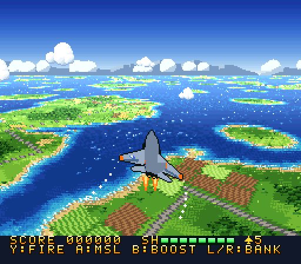
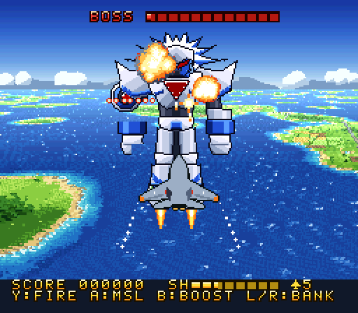
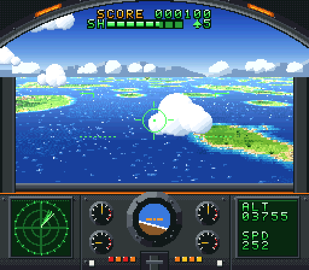
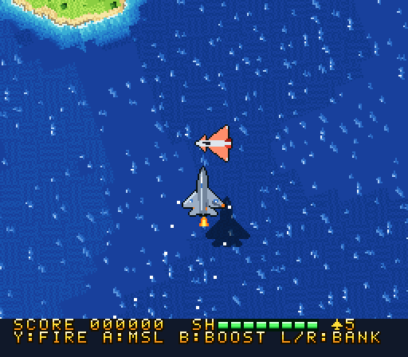
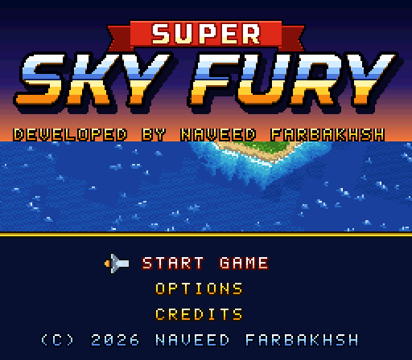
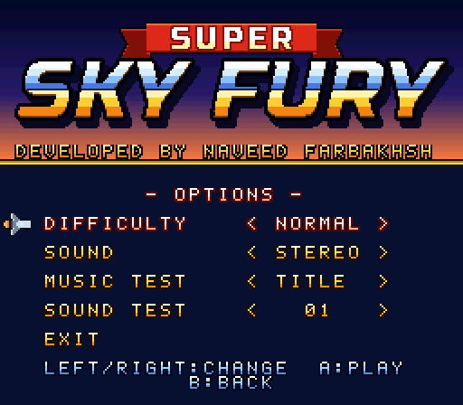
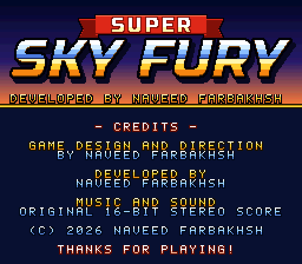

# SUPER SKY FURY

**A Mode 7 jet-combat shooter for the Super Nintendo, written in 65816 assembly.**
Developed by **Naveed Farbakhsh**.

### ▶ [Play it in your browser: naveedster.github.io/super-sky-fury](https://naveedster.github.io/super-sky-fury/)


Fly a fighter jet over an endless, procedurally generated ocean of islands, towns, and
airfields. Shoot down enemy waves, out-turn heat-seeking missiles, and take on a giant robot
boss, with a loud, wide stereo soundtrack and sound effects. The game runs on real SNES
hardware (through a flash cart such as an FXPak Pro/SD2SNES or EverDrive) and in any accurate
SNES emulator.

| | |
|---|---|
|  |  |
|  |  |

## Features

* **Three camera views**: a chase camera and a cockpit with a full instrument panel (radar,
  attitude ball, altitude and speed), both using per-scanline Mode 7 perspective, plus a
  rotating overhead view with translucent shadows.
* **Combat**: twin cannons, lock-on heat-seeking missiles, an afterburner, and hard banking.
  Enemies fire tracers and missiles, with on-screen warnings telling you how to dodge.
* **Boss fight**: a giant robot with weak points, three attack phases, and its own music.
* **Original 16-bit soundtrack**: title, stage, and boss themes plus a victory jingle on a
  custom SPC700 sound driver. Sound effects are hard-panned and moving (STEREO by default, with
  a MONO option).
* **Title screen and menu**: an animated Mode 7 background, OPTIONS (difficulty, stereo/mono,
  music test, sound test), and CREDITS.
* **Three difficulty levels**:

  | | Lives | Boss health | Enemy fire |
  |---|---|---|---|
  | EASY | 7 | lower | slower |
  | NORMAL | 5 | standard | standard |
  | HARD | 3 | higher | faster |

* Runs at a steady **60 fps** on a stock console: 512 KB LoROM/FastROM, no enhancement chip,
  NTSC.

| Menu | Options | Credits |
|---|---|---|
|  |  |  |

## Play it

* **In your browser:** <https://naveedster.github.io/super-sky-fury/>. It uses an embedded snes9x
  emulator (EmulatorJS) with stereo sound, keyboard, gamepad, and on-screen touch controls.
* **Download:** grab **[`dist/super_sky_fury.sfc`](dist/super_sky_fury.sfc)** (or the ROM attached to
  the [latest release](https://github.com/naveedster/super-sky-fury/releases/latest)) and open it in an
  emulator, or copy it to a flash cart.

## Controls

| Button | Action |
|---|---|
| START | title: open the menu; in game: pause / resume; GAME OVER: back to the title |
| D-pad | menu: choose (left/right changes an option) |
| A / START | menu: confirm. B: back |
| D-pad left/right | turn (the jet banks) |
| D-pad up/down | climb / dive |
| Y (hold) | guns |
| A | heat-seeking missile (locks onto the nearest enemy ahead) |
| B | afterburner |
| L / R | hard bank (tighter turn) |
| SELECT or X | change view: chase -> overhead -> cockpit (chase <-> cockpit during the boss) |

Scoring: 100 points for a gun kill and 200 for a missile kill. You get an extra life every
10,000 points (up to 9).

## Building from source

Requirements:

* [cc65](https://cc65.github.io/) (`ca65` and `ld65`)
* Python 3 with `numpy` and `Pillow`

```sh
./build.sh
```

The script regenerates all graphics, tables, and music from the Python generators in `tools/`
and `music/`, assembles `src/main.s`, links it with `src/lorom.cfg`, and fixes the header
checksum. The output is `build/super_sky_fury.sfc`. The build is deterministic and reproduces
the ROM in `dist/` byte for byte.

```
src/        65816 source (main loop and rendering, combat, enemy attacks, boss, title/menu)
tools/      asset generators (terrain, sprites, boss, title logo), checksum fixer,
            headless libretro test harness (lrharness.c), test scripts
music/      SPC700 driver, BRR encoder, song and SFX generators, plus .spc/.mp3 renders
tests/      scripted title-menu test runs
docs/       website (GitHub Pages), technical notes, screenshots
dist/       the release ROM
```

## Tested on

| Emulator | Result |
|---|---|
| snes9x (libretro) | works |
| Snes9x 1.55, the core used by Delta (iOS) | works, pixel-identical to snes9x |
| bsnes (default and accuracy settings) | works |
| bsnes2014 accuracy | works, 60 fps with no dropped frames |
| Mesen-S | works |

Audio has also been checked on snes9x2002/2005/2010, bsnes-hd, bsnes-mercury, and Mesen2.
For the full test methodology and the hardware-safety rules the code follows, see
[docs/TECHNICAL.md](docs/TECHNICAL.md).

## Credits

* **Game design, direction, and development**: Naveed Farbakhsh
* All code, graphics, music, and sound effects are original to this project.
* The logo font is [Russo One](https://fonts.google.com/specimen/Russo+One) by Jovanny Lemonad,
  under the SIL Open Font License 1.1 (`tools/fonts/OFL.txt`). It is used only at build time to
  render the logo tiles.
* Inspired by the "fly" web demo by [@creativedash](https://x.com/creativedash/status/2122000830895386680).
  No assets from it are used.

## License

[MIT](LICENSE). Copyright (c) 2026 Naveed Farbakhsh.

The Russo One font file in `tools/fonts/` remains under the SIL Open Font License 1.1.
